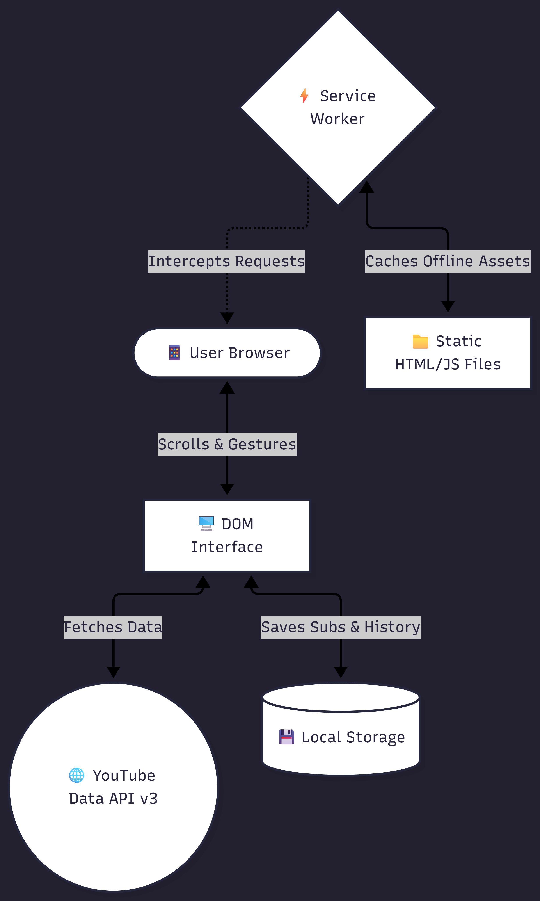
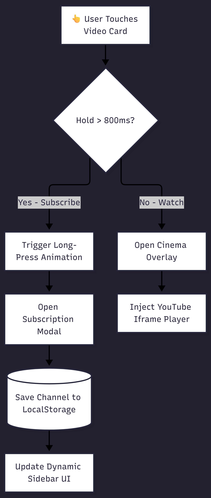

# 📺 MyTube: Advanced JAMstack YouTube Clone

A high-performance, client-side dynamic Single Page Application (SPA) built to replicate the core experience of YouTube. This project focuses on professional UI/UX, mobile-first design, and native-app functionality using modern web capabilities.

🌍 **[View It Live Here](https://raghuveer5465.github.io/youtube-clone/)**

---

## ✨ What You Can Do (Key Features)

*   📱 **Install as an App (PWA):** Fully installable on Android, iOS, and Desktop via Chrome. Includes a custom Service Worker for aggressive caching and fast load times.
*   🎬 **Watch Videos In-App:** Click any video card to launch a custom cinematic modal with an embedded YouTube iframe player.
*   👆 **Custom Touch Gestures:** Mimics native mobile apps—**long-press** (800ms) any video card to instantly subscribe to the creator.
*   ♾️ **Infinite Scrolling:** Effortlessly scroll to load more content. Uses intelligent API batching to load up to 60 unique videos per session.
*   🦴 **Skeleton Loaders:** Modern pulsing placeholder cards eliminate visual friction while data is fetched.
*   💾 **Persistent State:** Your search history and custom channel subscriptions are saved locally to your device via `localStorage`.

---

## 🏗️ System Architecture & Data Flow

MyTube operates on a **JAMstack** architecture (JavaScript, APIs, and Markup). There is no backend server; all logic, state management, and API routing are handled dynamically in the client's browser.

---

## ⚙️ How It Works Under the Hood

### 1. The Interaction Engine (Custom Event Listeners)
To provide a native mobile feel in a web browser, standard `<button>` tags were abandoned. Instead, the app utilizes a custom event listener matrix that tracks `touchstart`, `touchend`, `touchmove`, `mousedown`, and `mouseup` to calculate gesture intent.

### 2. Intelligent Data Fetching
To minimize YouTube API Quota limits, the application heavily optimizes network requests:
1. Video data is fetched by category.
2. Channel IDs are extracted and deduplicated.
3. A single, batched API request is sent to fetch channel logos for up to 50 videos simultaneously.
4. Data is mapped and formatted before injecting it into the DOM.
